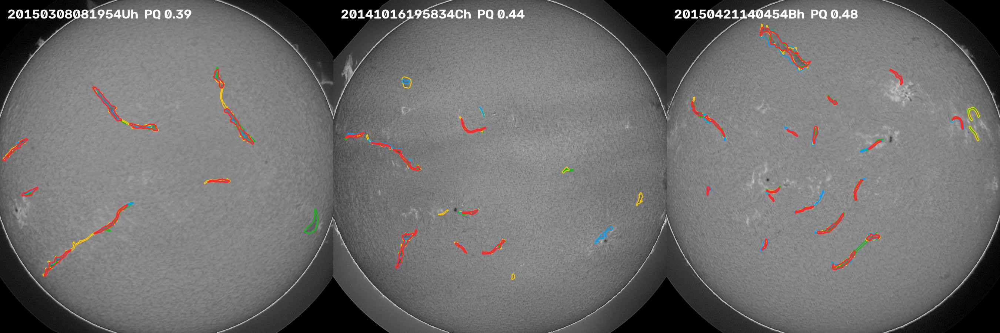
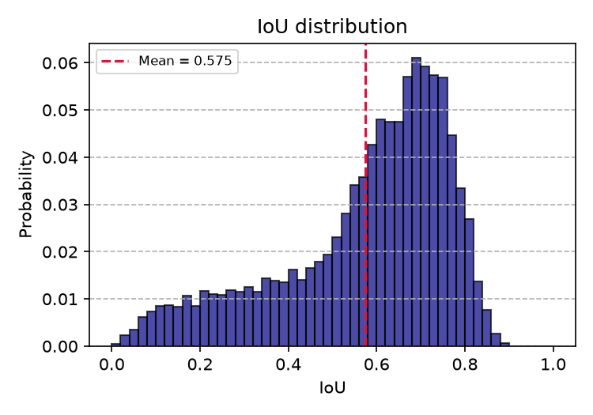
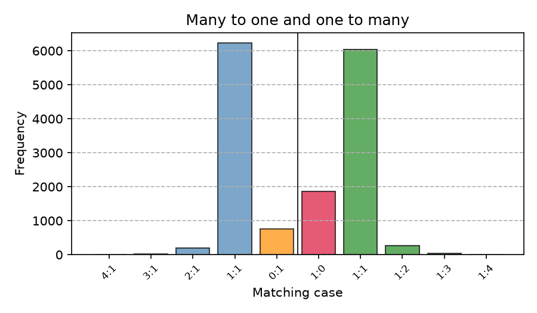

<!--
Kaggle solution writeup, published 2026-11-17 at
https://www.kaggle.com/competitions/filament-segmentation-2026/writeups/public-0-37-private-0-36-u-net-a-threshold-tre
(Team tab > Create Solution Writeup); DOI 10.34740/KAGGLE/W/127014.
Title (field):    Public 0.37 / Private 0.36: U-Net, a threshold tree and rotated-crop refiners
Subtitle (field): One U-Net at 1536 px, learned instance selection on a 12-level component tree, and native-resolution refiners in crops turned along each filament
Card image:       docs/figures/writeup_card.jpg (560 x 280)
Images below point to the public GitHub repo. If the editor does not render external images, upload the same
files with its image button and replace the URLs:
  docs/figures/qualitative_tree.jpg, docs/figures/ooftree_iou.png, docs/figures/ooftree_m2n.png
Attachments / links: the GitHub repo, and report/main.pdf (the 4-page report).
-->

## Summary

One U-Net (ResNet-34 encoder) at 1536 px, run on four flipped views. It feeds a tree of candidate instances at twelve
thresholds; a learned scorer picks a disjoint set of nodes exactly; a second stage redraws each picked filament at native
resolution in a crop turned along its own axis.

- Out-of-fold PQ **0.440** (95% bootstrap interval 0.431-0.449) on all 707 training images
- Public LB **0.37**, private LB **0.36**
- One human annotator scored against another on the same images gives PQ **0.340**

Code, weights, a notebook that reproduces the submission byte for byte, and the 4-page report:
https://github.com/kabartay/filament-segmentation-2026


*Out-of-fold predictions of stage 1 (red) on three validation images with three annotators (green, yellow, blue),
at the 50th, 75th and 90th percentile of image PQ. Many misses are filaments that only one annotator marked.*

## Validation came first

The public LB scores about 90 images to two decimals (about +-0.027), so it cannot resolve steps of +0.005. Every
decision was made out of fold instead:

- **Split:** 5 folds by calendar month, so all annotators of one image and neighbouring days stay together.
- **Metric:** our metric code reproduces the organisers' PQ notebook [2] exactly (PQ as in [3], pooled over
  annotator-image entries, TP at IoU > 0.5).
- **Adoption rule, fixed in advance:** a paired bootstrap over images; adopt only if the 95% interval excludes 0
  and the gain is positive on all five folds.

After the close, the private LB never dropped from one submission to the next, in line with the out-of-fold gains.

## Stage 1: segmentation and selection

1. **Target:** the fraction of annotators marking each pixel, so the network learns where annotators agree.
2. **Network:** U-Net [4] with an ImageNet ResNet-34 encoder [5] from segmentation_models_pytorch [6], 1 channel,
   BCE + soft Dice. Trained 40 epochs at 1536 px (1024 px was worse on four of five folds; 2048 px was no better).
3. **Views:** identity, horizontal, vertical and both flips. The mean is the probability map and the per-pixel
   standard deviation is a "view spread" feature.
4. **Candidate tree:** at each of twelve thresholds (0.25-0.80), a 31 px closing decides which fragments belong
   together, and components of at least 100 px are candidates. Higher-threshold components nest inside lower ones,
   so the candidates form a forest.
5. **Hurdle scorer:** each node gets P(match) x E[IoU | match], from gradient-boosted models (scikit-learn [7])
   trained on out-of-fold nodes with 32 features (shape, probability, contrast, disk position, tree context, view
   spread).
6. **Selection:** dynamic programming on the forest picks the disjoint set of nodes maximising the sum of
   (score - 0.26).

Steps 4-6 follow the first stage of a public notebook [8]. This gains +0.005 [0.001, 0.008] over a single threshold
with the same kind of scorer, and +0.018 [0.013, 0.023] over the 1024 px hand-tuned rule.

## Stage 2: rotated-crop refiners

Following the second stage of the same notebook [8]:

- **Crop:** each selected filament is redrawn in a 384 x 128 crop turned along its principal axis, at native
  2048 px resolution.
- **Inputs (4 channels):** the image, the stage-1 probability, the filament itself and the other selected filaments.
- **Target:** the mean mask of the annotators who drew that filament.
- **Models (ten in all):** one UNet++ [9] per fold, plus one U-Net per fold trained with extra crops of tree nodes at
  other thresholds (fragments and over-merged seeds) and a small affine jitter.
- **Test time:** all ten averaged over four flips, thresholded at 0.40, and pasted back so that masks stay disjoint.

Out of fold, each fold's crops are redrawn only by refiners that did not see them. This gives +0.013 [0.010, 0.016]
over stage 1, on all five folds.

## Results

| Sub | Pipeline | OOF PQ | Public | Private |
|---|---|---|---|---|
| 4 | one U-Net on all images, hand rule | 0.409 | 0.35 | 0.33 |
| 5 | 1536 px, 4 flips, learned scorer | 0.422 | 0.35 | 0.34 |
| 6 | 12-level tree + hurdle scorer + exact selection | 0.427 | 0.36 | 0.34 |
| 7 | + one U-Net refiner per fold | 0.433 | 0.37 | 0.36 |
| **8** | + UNet++ and jitter U-Net refiners (final) | **0.440** | 0.37 | 0.36 |



*The organisers' evaluation plots on out-of-fold stage-1 predictions: the IoU of every annotated/predicted pair that
overlaps (mean 0.575), and how predictions and annotations link up (left: annotations per prediction; right:
predictions per annotation). Most links are one-to-one.*

## What did not help

Each of these was measured out of fold; the numbers are in `docs/DESIGN.md` in the repository.

- **Models:** Mask R-CNN [10] and detector + U-Net combinations; ResNet-50 and ConvNeXt-T encoders.
- **Inputs and loss:** limb-darkening correction; Lovasz loss [11]; 2048 px input.
- **Post-processing:** hysteresis, size-dependent confidence, growing or shrinking masks.
- **Selection:** 15 tree levels; more scorer capacity; a different selection threshold.
- **Refiners:** weighted refiner blends; a refiner trained on negative crops; a UNet++ on the jitter crops (+0.002,
  not on all five folds).

The main limit is the annotators themselves. 296 of the 707 training images have two or three annotators, who
often disagree on how to group or extend a filament. 37% of our errors are near misses at IoU 0.3-0.5.

## Data

- **External data:** none. Only the competition's training data was used, with no external filament masks.
- **Images and annotations:** MAGFiLO [1] and the competition [2]. The images are NSO/GONG data.
- **Acknowledgement:** this work uses GONG data obtained by the NSO Integrated Synoptic Program, managed by the
  National Solar Observatory, which is operated by AURA, Inc. under a cooperative agreement with the National Science
  Foundation and with contribution from NOAA.

## References

1. A. Ahmadzadeh et al. A dataset of manually annotated filaments from H-alpha observations. *Scientific Data* 11,
   1031 (2024). https://doi.org/10.1038/s41597-024-03876-y
2. A. Ahmadzadeh, D. J. Kempton, Q. Li and A. A. Pevtsov. Solar Filament Segmentation Challenge 2026. Kaggle (2026).
   https://kaggle.com/competitions/filament-segmentation-2026
3. A. Kirillov, K. He, R. Girshick, C. Rother and P. Dollár. Panoptic Segmentation. CVPR (2019).
4. O. Ronneberger, P. Fischer and T. Brox. U-Net: Convolutional Networks for Biomedical Image Segmentation.
   MICCAI (2015).
5. K. He, X. Zhang, S. Ren and J. Sun. Deep Residual Learning for Image Recognition. CVPR (2016).
6. P. Iakubovskii. Segmentation Models Pytorch (2019). https://github.com/qubvel-org/segmentation_models.pytorch
7. F. Pedregosa et al. Scikit-learn: Machine Learning in Python. *JMLR* 12 (2011).
8. tushhaaarrrr. Solar Filament Segmentation 2026 (0.40). Kaggle notebook (2026).
   https://www.kaggle.com/code/tushhaaarrrr/solar-filament-segmentation-2026-0-40. Our implementation, features
   (including the view spread) and refiner ensemble are our own.
9. Z. Zhou, M. M. R. Siddiquee, N. Tajbakhsh and J. Liang. UNet++: A Nested U-Net Architecture for Medical Image
   Segmentation. DLMIA (2018).
10. K. He, G. Gkioxari, P. Dollár and R. Girshick. Mask R-CNN. ICCV (2017).
11. M. Berman, A. Rannen Triki and M. B. Blaschko. The Lovász-Softmax Loss. CVPR (2018).

## How to cite this solution

```bibtex
@article{mukharbek_organokov_2026,
  title     = {Public 0.37 / Private 0.36: U-Net, a threshold tree and rotated-crop refiners},
  url       = {https://www.kaggle.com/w/127014},
  DOI       = {10.34740/KAGGLE/W/127014},
  journal   = {Kaggle},
  publisher = {Kaggle},
  author    = {Mukharbek Organokov},
  year      = {2026}
}
```
